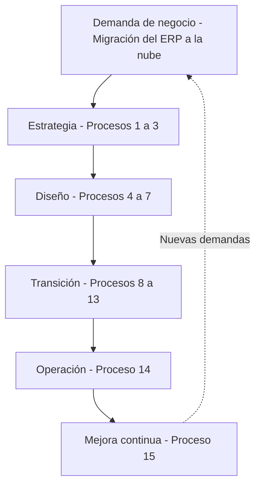
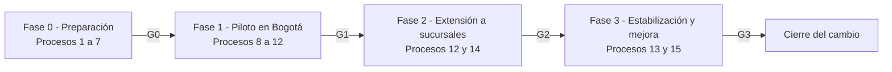

# 🏢 Arquitectura de Servicios de TI en una PYME – Flujo de Cambios Evolutivos con ITIL v3

### *15 procesos ITIL v3 en las cinco fases del ciclo de vida, madurez proporcional al riesgo y una hoja de ruta ejecutable para migrar un ERP a la nube*

**Asignatura: Servicios de Tecnología de la Información · Fundación Universitaria Internacional de La Rioja (UNIR) · Actividad No. 2 (Laboratorio)**

**[Contexto](#-contexto-y-alcance) • [Contenido](#-contenido-del-repositorio) • [Marcos](#-marcos-y-normas-utilizados) • [Arquitectura](#-arquitectura) • [Madurez](#-niveles-de-madurez) • [Hoja de ruta](#-hoja-de-ruta-y-puertas-de-decisión) • [Autor](#-autor)**

---

## 📋 Tabla de Contenidos

- [🎯 Contexto y Alcance](#-contexto-y-alcance)
- [📁 Contenido del Repositorio](#-contenido-del-repositorio)
- [🧰 Marcos y Normas Utilizados](#-marcos-y-normas-utilizados)
- [🏗️ Arquitectura](#-arquitectura)
- [🔁 Secuencia de Procesos (Tabla 1)](#-secuencia-de-procesos-tabla-1)
- [📈 Niveles de Madurez](#-niveles-de-madurez)
- [🧩 Del Enunciado al Documento](#-del-enunciado-al-documento)
- [⚠️ Riesgos y Responsabilidades](#-riesgos-y-responsabilidades)
- [🚦 Hoja de Ruta y Puertas de Decisión](#-hoja-de-ruta-y-puertas-de-decisión)
- [✅ Decisiones de Diseño](#-decisiones-de-diseño)
- [📖 Cómo Consultar el Documento](#-cómo-consultar-el-documento)
- [📝 Nota](#-nota)
- [👤 Autor](#-autor)

---

## 🎯 Contexto y Alcance

Este repositorio contiene el desarrollo de la **Actividad No. 2: Laboratorio – Implantación de una arquitectura de servicios de TI en una PYME** de la asignatura **Servicios de Tecnología de la Información**. El trabajo define la **secuencia de procesos de ITIL v3** que gobierna el flujo de cambios evolutivos de una PYME y precisa, para cada proceso, la **actividad** que realiza y el **nivel de madurez** con el que debe operar.

El caso es **DistriAndina S.A.S.**, una distribuidora colombiana de insumos tecnológicos (nombre ficticio, caso realista) con 60 empleados, tres sedes (Bogotá, Medellín y Cali) y un equipo de TI de tres personas, que migra su **ERP local** (servidor de 8 años sin soporte) a un **ERP en la nube (SaaS)** con facturación electrónica ante la DIAN y sincronización de inventario con su tienda en línea.

> **Problema:** gobernar un cambio evolutivo mayor en una empresa pequeña sin catálogo, sin SLA y sin procedimiento de cambios.
> **Enfoque:** ciclo de vida completo de ITIL v3 con **madurez proporcional**: rigor alto solo donde el riesgo es alto.
> **Alcance:** 15 procesos → Tabla 1 (secuencia y actividades) → Tabla 2 (madurez actual y objetivo) → riesgos, RACI, hoja de ruta y alineación con COBIT e ISO/IEC 38500.

### 🌟 ¿Qué demuestra este trabajo?

- 🔄 **Un flujo que recorre todo el ciclo de vida**: el cambio no se reduce a autorizar un despliegue; pasa por estrategia, diseño, transición, operación y mejora continua.
- ⚖️ **Madurez proporcional al riesgo**: nivel 3 (Definido) en seis procesos críticos y nivel 2 (Repetible) en los nueve restantes.
- 🧪 **El nivel cambia las actividades**: se muestra cómo se ejecutan cuatro procesos en los niveles 1, 2 y 3.
- 🛡️ **Riesgo concentrado y mitigado**: seis riesgos (datos, facturación, accesos, proveedor, adopción y costos) asignados a procesos concretos.
- 🏛️ **Alineado con el gobierno de TI**: los 15 procesos cubren los cuatro dominios de COBIT y los seis principios de ISO/IEC 38500.
- 🚦 **Un diseño revisable**: hoja de ruta por fases con puertas de decisión G0–G3 que permiten continuar, ajustar o detener.

---

## 📁 Contenido del Repositorio

<table align="center">
  <tr><th>Elemento</th><th>Descripción</th></tr>
  <tr><td colspan="2"><b>📂 raíz</b></td></tr>
  <tr><td><code>Desarrollo_Actividad_2_Alejandro_De_Mendoza_FIN.pdf</code></td><td>📄 <b>Documento entregado</b> (14 páginas): introducción, memoria explicativa, caso de la PYME, <b>Tabla 1</b> (secuencia de 15 procesos), <b>Tabla 2</b> (madurez actual y objetivo), riesgos, matriz RACI, hoja de ruta, alineación con COBIT e ISO/IEC 38500, análisis de sensibilidad, conclusiones y bibliografía</td></tr>
  <tr><td><code>README.md</code></td><td>📄 Este documento</td></tr>
  <tr><td><code>.gitignore</code></td><td>🚫 Mantiene en local los editables de Word, las copias de seguridad y los archivos de trabajo</td></tr>
</table>

---

## 🧰 Marcos y Normas Utilizados

| Marco o norma | Uso en el documento |
|:---|:---|
| **ITIL v3** | Ciclo de vida del servicio (estrategia, diseño, transición, operación, mejora continua) y selección de los 15 procesos |
| **Marco de Madurez de Procesos de ITIL** | Escala de cinco niveles (Inicial, Repetible, Definido, Gestionado, Optimizado), adaptada a una PYME |
| **COBIT** | Verificación de que el flujo cubre los cuatro dominios: qué controlar (Tabla 7) |
| **ISO/IEC 38500** | Seis principios de gobierno de TI como lista de verificación del diseño (Tabla 8) |
| **ISO/IEC 20000-1** | Marco de referencia del sistema de gestión del servicio |
| **Ley 1581 de 2012 y normativa DIAN** | Requisitos de protección de datos personales y de facturación electrónica |

---

## 🏗️ Arquitectura

Los procesos **1 a 7** responden a si conviene el cambio y cómo debe ser el servicio, antes de tocar producción. Los procesos **8 a 13** ejecutan el cambio en el orden natural de la transición: planificar, autorizar, registrar la línea base, probar, desplegar y evaluar. El proceso **14** estabiliza el servicio y el **15** convierte lo aprendido en mejora y reabre el ciclo.

---

## 🔁 Secuencia de Procesos (Tabla 1)

| # | Proceso | Fase | Actividad principal en DistriAndina |
|:---:|:---|:---:|:---|
| 1 | Gestión de la Demanda | Estrategia | Convierte la necesidad de pedidos en línea y facturación inmediata en una solicitud formal de cambio |
| 2 | Gestión del Portafolio de Servicios | Estrategia | Evalúa tres alternativas (mantener, actualizar *on-premise*, migrar) y prioriza «ERP en la nube» |
| 3 | Gestión Financiera | Estrategia | Presupuesta licencias, migración y capacitación; compara el costo total a tres años |
| 4 | Gestión del Catálogo de Servicios | Diseño | Retira «ERP local» y publica «ERP en la nube» con responsable y dependencias |
| 5 | Gestión de Niveles de Servicio | Diseño | Acuerda un SLA con las áreas usuarias y un OLA interno con TI |
| 6 | Gestión de Proveedores | Diseño | Selecciona al proveedor y formaliza el contrato con cláusula de salida y portabilidad de datos |
| 7 | Gestión de la Seguridad de la Información | Diseño | Doble factor, roles por perfil, cifrado, copias y cumplimiento de la Ley 1581 |
| 8 | Planificación y Soporte a la Transición | Transición | Plan de migración con hitos, ventana de corte, comunicación y reversión |
| 9 | Gestión de Cambios | Transición | RFC, evaluación de impacto y riesgo, y autorización por el comité de cambios |
| 10 | Gestión de la Configuración y Activos | Transición | CMDB ligera con línea base antes y después del cambio |
| 11 | Validación y Pruebas | Transición | Conciliación de datos, pruebas de integraciones y aceptación de usuarios clave |
| 12 | Gestión de Entregas y Despliegues | Transición | Piloto en Bogotá y extensión a Medellín y Cali con reversión activa |
| 13 | Evaluación | Transición | Revisión posterior a la implementación y cierre del cambio |
| 14 | Gestión de Incidencias | Operación | Soporte reforzado durante las dos primeras semanas dentro del SLA |
| 15 | Mejora del Servicio | Mejora continua | Plan de mejora (SIP) con lecciones aprendidas e indicadores |

---

## 📈 Niveles de Madurez

Escala adoptada (adaptada del Marco de Madurez de Procesos de ITIL):

| Nivel | Nombre | Cómo se ve en una PYME |
|:---:|:---|:---|
| 1 | Inicial | Informal, depende de personas concretas, sin documentar |
| 2 | Repetible | Procedimiento básico y registros mínimos |
| 3 | Definido | Documentado, con roles, entradas y salidas, aplicado de forma estándar |
| 4 | Gestionado | Medido con indicadores y control de desviaciones |
| 5 | Optimizado | Mejora continua basada en datos, con automatización |

Nivel objetivo por proceso (Tabla 2):

| Nivel objetivo | Procesos |
|:---|:---|
| **3 – Definido** | Proveedores, Seguridad de la información, Cambios, Validación y pruebas, Entregas y despliegues, Incidencias |
| **2 – Repetible** | Demanda, Portafolio, Financiera, Catálogo, Niveles de servicio, Planificación de la transición, Configuración y activos, Evaluación, Mejora del servicio |

<b>📊 Ver nivel actual y objetivo de los 15 procesos</b>

| # | Proceso | Actual | Objetivo |
|:---:|:---|:---:|:---:|
| 1 | Demanda | 1 | 2 |
| 2 | Portafolio | 1 | 2 |
| 3 | Financiera | 2 | 2 |
| 4 | Catálogo | 1 | 2 |
| 5 | Niveles de servicio | 1 | 2 |
| 6 | Proveedores | 2 | **3** |
| 7 | Seguridad | 1 | **3** |
| 8 | Planificación de la transición | 1 | 2 |
| 9 | Cambios | 1 | **3** |
| 10 | Configuración y activos | 1 | 2 |
| 11 | Validación y pruebas | 1 | **3** |
| 12 | Entregas y despliegues | 1 | **3** |
| 13 | Evaluación | 1 | 2 |
| 14 | Incidencias | 2 | **3** |
| 15 | Mejora del servicio | 1 | 2 |

El plan exige subir de nivel en 14 de los 15 procesos; Gestión Financiera ya está en el nivel 2 y se mantiene.

> **¿Por qué nivel 3 y no 4?** Medir y controlar desviaciones con indicadores exige tiempo y herramientas que tres técnicos no pueden dedicar a un cambio que sucede una vez. El nivel 4 queda como horizonte de una segunda fase.

---

## 🧩 Del Enunciado al Documento

| Requisito de la actividad | Cómo se resuelve |
|:---|:---|
| **Elegir una PYME** y un cambio evolutivo | Sección 3: DistriAndina S.A.S. y la migración de su ERP a la nube |
| **Secuencia de procesos** de ITIL v3 del flujo de cambios | Sección 4, Figura 1 y **Tabla 1** |
| **Actividad** que realiza cada proceso | Columna de actividades de la **Tabla 1** |
| **Nivel de madurez** de cada proceso | Sección 5, **Tabla 2** y Figura 2 |
| **Cómo altera el nivel** las actividades | Tabla 3: cuatro procesos en los niveles 1, 2 y 3 |
| **Memoria explicativa** del enfoque | Sección 2: enfoque, alternativas consideradas, criterios y supuestos |

---

## ⚠️ Riesgos y Responsabilidades

| ID | Riesgo | Procesos que lo mitigan |
|:---:|:---|:---:|
| R1 | Pérdida o descuadre de datos en la migración | 10 y 11 |
| R2 | Interrupción de la facturación electrónica | 9 y 12 |
| R3 | Accesos indebidos o incumplimiento de la Ley 1581 | 7 |
| R4 | Dependencia del proveedor del ERP | 5 y 6 |
| R5 | Rechazo o errores de uso por parte de los usuarios | 8, 12 y 14 |
| R6 | Sobrecostos o retrasos del proyecto | 2, 3 y 8 |

<b>👥 Ver la matriz RACI del cambio</b>

GG: gerente general · AF: administración y finanzas · CTI: coordinador de TI · PRV: proveedor del ERP · UC: usuarios clave

| Actividad | GG | AF | CTI | PRV | UC |
|:---|:---:|:---:|:---:|:---:|:---:|
| Aprobar el caso de negocio y el presupuesto | A | R | C | I | I |
| Definir el SLA y el contrato con el proveedor | A | C | R | C | I |
| Autorizar el cambio y la ventana (comité) | A | C | R | C | C |
| Migrar y cargar los datos | I | C | A | R | C |
| Ejecutar las pruebas de aceptación | I | C | A | C | R |
| Desplegar y dar soporte reforzado | I | I | A | R | C |
| Revisión posterior y plan de mejora | A | C | R | C | C |

---

## 🚦 Hoja de Ruta y Puertas de Decisión

| Puerta | Decide | Condiciones para avanzar |
|:---:|:---|:---|
| **G0** | Autorizar el piloto | Caso de negocio, SLA, contrato y controles de seguridad aprobados; presupuesto asignado |
| **G1** | Extender a Medellín y Cali | RFC autorizada, pruebas de aceptación firmadas, migración conciliada y reversión probada |
| **G2** | Retirar el servidor antiguo | Sin incidencias críticas durante dos semanas, facturación estable y usuarios capacitados |
| **G3** | Cerrar el cambio | Revisión posterior hecha, indicadores revisados y plan de mejora aprobado |

En cada puerta la gerencia puede **continuar, ajustar o detener** el despliegue, de modo que el cambio no depende de un único corte.

---

## ✅ Decisiones de Diseño

| Decisión | Dónde se justifica |
|:---|:---|
| 🔄 **Ciclo de vida completo con madurez proporcional** (alternativa A2) frente a no gobernar, solo gestión de cambios o ITIL completo | Sección 2.2 |
| ⚖️ **Nivel 3 solo donde el riesgo es alto**: datos, facturación electrónica y accesos | Sección 5 y Tabla 2 |
| 🧭 **Proporcionalidad**: no hace falta cumplir todo un marco; depende de la madurez, los activos y las personas | Sección 2.3 |
| ⏸️ **Procesos diferidos, no descartados**: Capacidad, Disponibilidad, Continuidad, Eventos, Problemas, Acceso y Petición | Sección 2.3 |
| 🚦 **Despliegue por fases con puertas** en lugar de un único corte | Sección 6.3 |
| 🏛️ **COBIT dice qué controlar; ITIL e ISO, cómo hacerlo** | Sección 6.4 |
| 🔍 **Análisis de sensibilidad**: en qué condiciones el diseño dejaría de ser adecuado | Sección 6.5 |

---

## 📖 Cómo Consultar el Documento

1. Abrir `Desarrollo_Actividad_2_Alejandro_De_Mendoza_FIN.pdf` (la tabla de contenido tiene enlaces a cada sección).
2. Leer el **resumen ejecutivo** de la sección 1.1 para ver el resultado de un vistazo.
3. Revisar la **Tabla 1** (sección 4) para la secuencia de procesos y sus actividades.
4. Revisar la **Tabla 2** (sección 5) para los niveles de madurez.
5. Consultar la **sección 6** para riesgos, responsabilidades, hoja de ruta y alineación con COBIT e ISO/IEC 38500.

| Si busca… | Vaya a |
|:---|:---|
| 🎯 El resultado en pocas líneas | Resumen ejecutivo (sección 1.1) |
| 🔁 Qué procesos y en qué orden | Sección 4 · Figura 1 · Tabla 1 |
| 📈 Con qué rigor opera cada proceso | Sección 5 · Tabla 2 · Figura 2 |
| 🚦 Cómo se pone en marcha | Sección 6 · Tablas 4 a 9 |

---

## 📝 Nota

Este trabajo corresponde a una **actividad académica** y se elaboró con fines exclusivamente formativos. **DistriAndina S.A.S. es una empresa ficticia**; los niveles de madurez actuales son un diagnóstico supuesto que debería confirmarse con una evaluación formal antes de ejecutar el cambio.

---

## 👤 Autor

Este trabajo fue desarrollado en el marco de la asignatura **Servicios de Tecnología de la Información** de la **Fundación Universitaria Internacional de La Rioja (UNIR)** (Bogotá, Colombia), bajo la orientación de los docentes **Johan Sebastián Giraldo Hurtado** y **Glenn Elmer Hernández Camelo**.

| Autor | Perfil |
|:---:|:---:|
| ***Alejandro De Mendoza*** |  |

---

### 🏢 *Pocos procesos, bien ejecutados: el rigor se ajusta al riesgo*

**Servicios de Tecnología de la Información · ITIL v3 · Flujo de cambios evolutivos**

