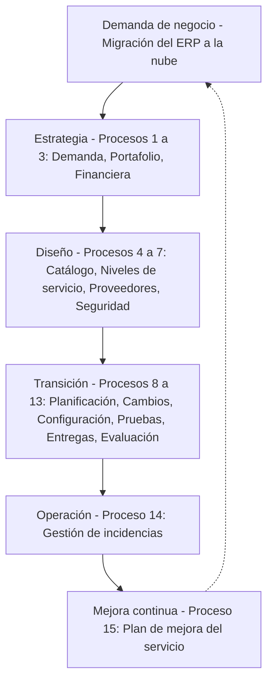

# Implantación de una Arquitectura de Servicios de TI en una PYME - ITIL v3 - Flujo de Cambios Evolutivos y Niveles de Madurez

---

Este repositorio contiene el desarrollo de la **Actividad No. 2 (Laboratorio)** de la asignatura **Servicios de Tecnología de la Información** (UNIR): el diseño del **flujo de cambios evolutivos** de una PYME con **ITIL v3**, aplicando **niveles de madurez** a cada proceso. El caso es la migración del ERP de **DistriAndina S.A.S.** (empresa ficticia, caso realista) a la nube.

## Contenido del repositorio:

- `Desarrollo_Actividad_2_Alejandro_De_Mendoza_FIN.pdf` → Documento entregado: memoria explicativa, **Tabla 1** (secuencia de 15 procesos ITIL v3 y sus actividades), **Tabla 2** (nivel de madurez actual y objetivo por proceso), riesgos, matriz RACI, hoja de ruta, alineación con COBIT e ISO/IEC 38500, conclusiones y bibliografía.
- `README.md` → Descripción del repositorio.

## Arquitectura

## Niveles de madurez adoptados

| Nivel objetivo | Procesos |
| --- | --- |
| **3 - Definido** | Proveedores, Seguridad de la información, Cambios, Validación y pruebas, Entregas y despliegues, Incidencias |
| **2 - Repetible** | Demanda, Portafolio, Financiera, Catálogo, Niveles de servicio, Planificación de la transición, Configuración y activos, Evaluación, Mejora del servicio |

## Cómo consultar el documento:

1. Abrir el archivo `Desarrollo_Actividad_2_Alejandro_De_Mendoza_FIN.pdf`.
2. Revisar la **Tabla 1** (sección 4) para la secuencia de procesos y sus actividades.
3. Revisar la **Tabla 2** (sección 5) para los niveles de madurez.
4. Consultar la sección 6 para riesgos, responsabilidades, hoja de ruta y alineación con COBIT.

## Autor:

Este trabajo fue desarrollado en el marco de la asignatura **Servicios de Tecnología de la Información**.

- ***Alejandro De Mendoza*** – [Perfil GitHub](https://github.com/AlejoTechEngineer)

---
